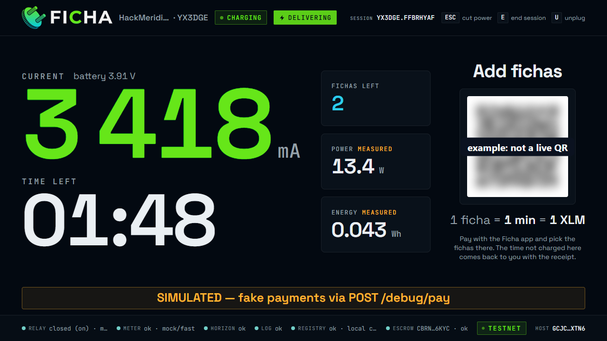
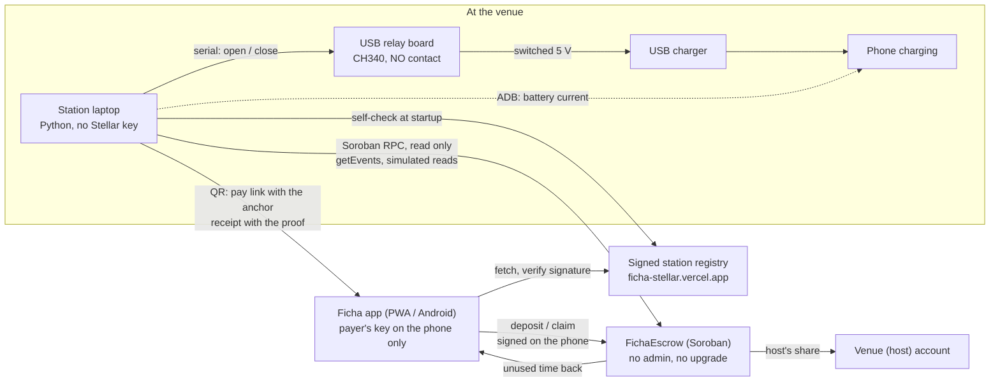
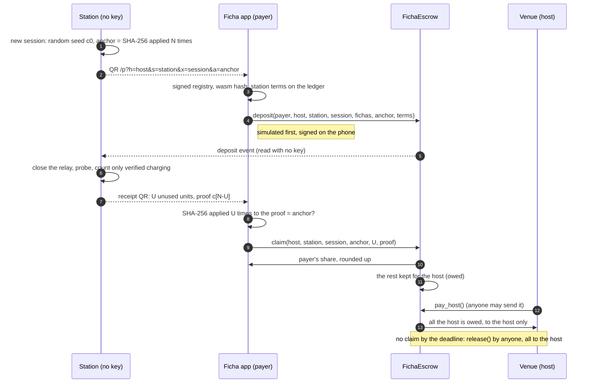
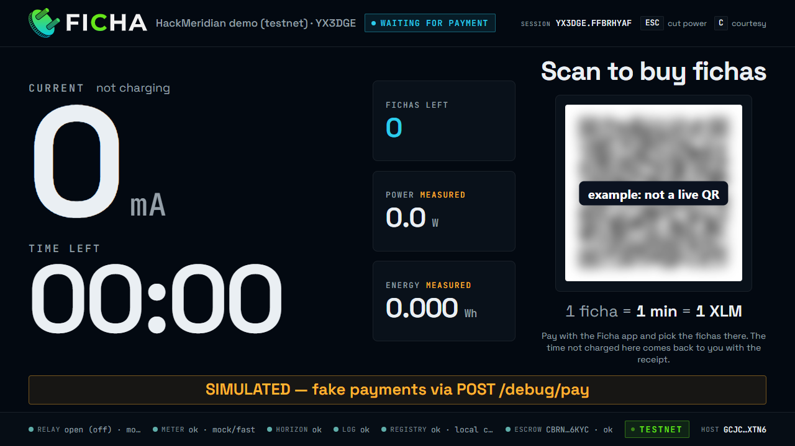
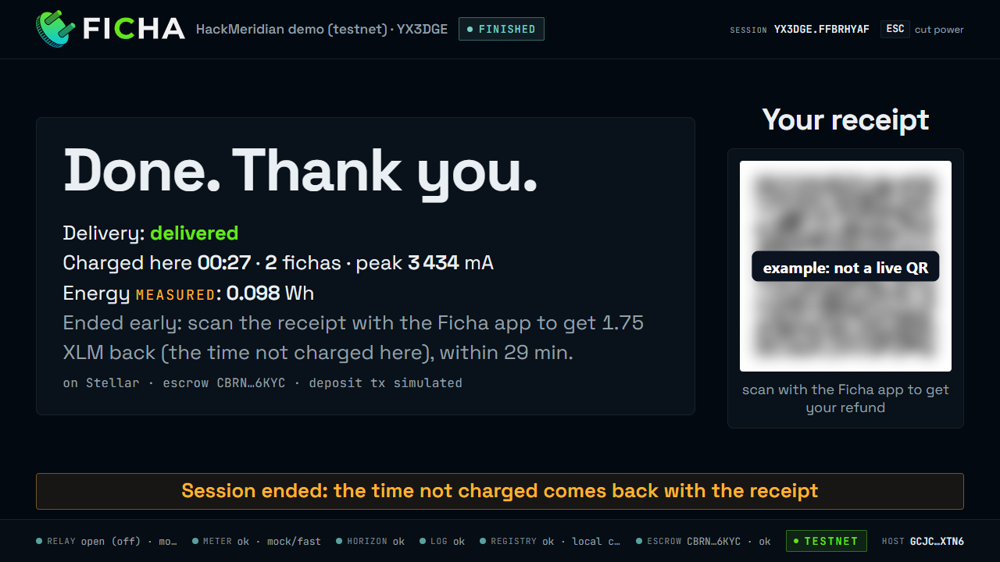
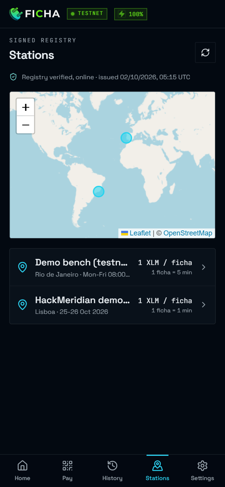
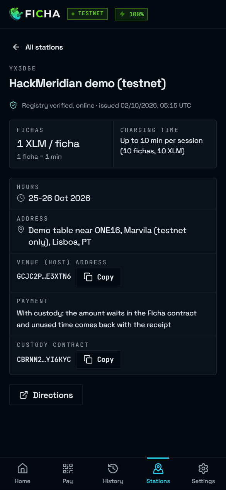

<p align="center">
  <picture>
    <source media="(prefers-color-scheme: dark)" srcset="brand/ficha-logo.svg">
    
  </picture>
</p>

# Ficha

**Pay-per-minute phone charging, paid on Stellar. The payer's money waits in
a Soroban escrow with no admin; the station proves, with a hash it reveals,
how many minutes it did not deliver, and the payer gets those back with one
tap on the receipt, before a deadline. The station holds no key.**


**[▶ Watch the 3-minute demo](https://youtu.be/cj7e7CjBzUM)**: a real station on a real bench, Stellar testnet, one take.

<!-- DECK_LINK -->

> **Testnet only.** Everything here runs on the Stellar test network with
> test XLM: no real money moves. The escrow contract is not audited, so its
> custody mode stays on testnet. On the public network a station takes direct
> payments only (a SEP-7 QR that pays the venue straight).

In Portugal a *ficha* is a plug; in Brazil it is a token, the coin for a
public phone. Ficha is both: a token of charging time at a plug in a public
place, a café, a coworking space, an event.

| | |
|---|---|
| Demo video (3 min) | <https://youtu.be/cj7e7CjBzUM> |
| Live app (PWA) | <https://ficha-stellar.vercel.app> |
| Demo station | `YX3DGE`, "HackMeridian demo (testnet)", in the [signed registry](registry/stations.json) |
| Escrow contract | [`CBRNN2W7…HYI6KYC`](https://stellar.expert/explorer/testnet/contract/CBRNN2W726PIWP7DLLCAOW663I2TBSMR6N7J7S4CGGUIWIXK4HYI6KYC) on testnet |
| A recorded run, every transaction linked | [docs/testnet-e2e.md](docs/testnet-e2e.md) |
| Architecture and trust model | [docs/architecture.md](docs/architecture.md) |
| The binding spec between station and app | [docs/station-app-contract.md](docs/station-app-contract.md) |
| For judges | [docs/hackathon/judges-quickstart.md](docs/hackathon/judges-quickstart.md) |

<p align="center">
  
</p>

## Public safety mode

Ficha also goes where a dead phone can be dangerous: bus and train
stations, airports, remote places, neighbourhoods with high rates of
violence or kidnapping. There a station's own Wi-Fi (a travel router running
OpenWrt and openNDS, a captive portal) gives **every phone, once a day,
2 minutes of charging and 2 minutes of internet, free**, shows the **local
emergency numbers first** (112 in Portugal; 190, 192 and 193 in Brazil), and
lets anyone **pay for more charging with no mobile data**: the Ficha app and
the Stellar endpoints it uses are open on that Wi-Fi before any sign-in.

- A phone is known only by a salted hash of its Wi-Fi MAC address, whose
  salt is new every day and deleted with its day. No MAC, IP or name is kept.
- No money moves for a free minute, and the station still holds no key: no
  Stellar key, no router password.
- The free charge is the station's (its relay, on the courtesy minute's
  path); the free internet is the router's (openNDS, and a script that lets
  each phone in once a day). The 2 minutes of internet are a courtesy for an
  ordinary phone, not a hard limit.
- Off by default (`WIFI_PORTAL=off`). The demo `.env` examples turn it on as
  a simulation on the laptop; the router's side is tested in WSL and first
  runs on the real router at HackMeridian.
- **Ficha is not an emergency service and does not replace one.**

Why, how, privacy, abuse and honest limits, who can fund the free minutes,
and the legal questions still open: [docs/public-safety.md](docs/public-safety.md).
The router's setup: [openwrt/README.md](openwrt/README.md).

## Try it in 60 seconds

**From anywhere**, with no station (start here when you review Ficha
remotely):

- Open <https://ficha-stellar.vercel.app/stations>: the stations of the
  signed registry on a map, with their payment mode and their contract.
- Open a real receipt from a recorded run:
  [`/r?v=2&m=YX3DGE.FZB7EM5D…`](https://ficha-stellar.vercel.app/r?v=2&m=YX3DGE.FZB7EM5D&n=t&h=GCJC2PFILBFQCYFBIDEQG3RZFNOA2ID7ULAEZJUZ5ULZX6BM3ME3XTN6&a=3&k=XLM&f=3&p=180&u=40&wh=0.160&x=3725&vd=d&c=1&t=1792753956&q=10&z=tDumkSbyaXiLO5bx8qnCs0K0a_oRvKTbJDsbuHwvMGk)
  (run M of [docs/testnet-e2e.md](docs/testnet-e2e.md), 23 October 2026).
  It opens read-only, with the station's statement (3 XLM for 3:00, 0:40
  charged here); only the wallet that paid can claim. What it proves is in
  the link itself: `q=10`, the refund units of 15 s not charged, and `z`,
  the hash that proves them. The app also checks a receipt in public, with
  no wallet: the anchor its proof leads to names a session on the
  contract, and the app shows it open, or how it settled (here: with the
  proof, 2.5 XLM back to the payer and 0.5 XLM to the venue) with links to
  its deposit and settlement. A settled session is found through its
  events, which the testnet RPC keeps for about 7 days (for this link,
  until about 30 October 2026); for an older link the page shows the
  statement only.
  The [claim transaction](https://stellar.expert/explorer/testnet/tx/e984afe7e8c8d0559a15b461071cb344cc445d1181f2c043390481b4482fc925)
  paid 2.5 XLM back to the payer and kept 0.5 XLM for the venue, owed to
  it on the contract until anyone sends `pay_host`, as
  [this one](https://stellar.expert/explorer/testnet/tx/a8219e11bf4d14b44c48ebac0503ece3fea24587f7d5e097e717495c60668cef)
  of run I did.
- Run a station on your own laptop (simulated relay and phone, real testnet
  deposits) and pay its QR from the app: [Run it locally](#run-it-locally).

**At a Ficha station** (the HackMeridian table in Lisbon, 25–26 October),
with the demo station `YX3DGE`:

1. Point your phone's camera at the QR on the station's screen. It opens the
   Ficha app at `https://ficha-stellar.vercel.app/p?…` (or the Android app,
   when it is installed).
2. No wallet on the phone yet? Pick **English**, tap **Create a new wallet**,
   write down the 24 words, type back the three it asks for, and set a PIN.
   On testnet the app activates the new wallet with test XLM from Friendbot
   right away (the **Activate with test XLM** button does it again if that
   failed), and goes back to the pay link.
3. The app checks the station in the signed registry and on the contract:
   "Station checked in the signed registry and on the custody contract."
   Choose the fichas (1 XLM per 1-minute ficha, up to 10) and tap **Pay**
   (the button shows the total: **Pay 2 XLM** for two fichas).
4. The station sees the deposit on the ledger within seconds and closes the
   relay. It counts time only after a probe has proved that the phone
   charges from it.
5. When the session ends, scan the receipt QR on the station's screen (the
   phone's camera opens it for 60 s; after that the copy on the waiting
   screen opens from the app's **Scan QR**) and tap
   **Get … XLM back**: one transaction pays your unused time back to you;
   the rest is kept in the contract for the venue, which collects it with
   `pay_host` (the **Collect** button of the app's host mode).

## The problem

- A phone at 3 % in a café has few options: ask the staff for a socket,
  rent a power bank through yet another app with an account, a card and a
  deposit, or go without.
- A venue that has sockets cannot sell a few minutes of electricity. A card
  payment for cents costs more than it brings in, and there is no meter or
  receipt to show what was delivered.
- Prepaid time is taken on trust. If the phone was charging from another
  socket, or stopped charging, nobody gives the unused money back.

Ficha: scan, pay a few fichas from a wallet on your phone, and pay only for
the time this station was verified to be charging your phone. The venue
receives the money. Ficha, the operator, never holds it.

## How it works





1. **A session gets a hash chain.** For each session the station draws a
   random 32-byte seed c[0] and hashes it forward: c[i+1] = SHA-256(c[i]),
   up to c[N], the **anchor**. N is the most refund units a session can
   hold (`YX3DGE`: 10 fichas × 60 s / 15 s = 40). The anchor goes in the pay
   QR; the seed stays on the station and signs nothing.
2. **The payer deposits.** The app checks the station in the signed
   registry, the contract's code (its wasm hash, pinned in the app) and the
   station's terms on the ledger, then simulates `deposit`, checks the
   authorization it asks for, and signs it on the phone. The money goes into
   FichaEscrow, under the session's ID and anchor, with the terms the payer
   signed.
3. **The station watches the ledger with no key.** It reads the contract's
   `deposit` events through a Soroban RPC, credits the fichas, and closes the
   relay.
4. **Only verified time counts.** The countdown starts when the meter sees
   current and a **probe** passes: the relay opens for 3 s and the current
   must drop. Current that keeps flowing comes from another charger. No
   current for 20 s pauses the countdown; a probe every 5 minutes checks
   again.
5. **The receipt carries the proof.** When the session ends, U = the paid
   time not charged, in refund units, rounded up for the payer. The receipt
   QR carries U and c[N−U]. Hashing it U times gives the anchor; hashing
   forward only ever proves fewer units, so proving more would take inverting
   SHA-256.
6. **The payer claims, or the venue is paid at the deadline.** `claim` pays
   ceil(amount × U / paid units) back to the payer in one transaction and
   keeps the rest for the venue, which `pay_host` pays out (anyone may send
   it; one call collects every claim's share). A claim never touches the
   venue's account, so nothing the venue does to its account can fail it.
   A session nobody claims goes to the venue in full after its deadline
   (the paid time + 28 minutes on the demo stations), which is what a
   direct payment does anyway.

| Waiting for a payment | Charging, time counting | Finished, with the receipt |
|---|---|---|
|  |  |  |

<p>
  
  
</p>

The station's screens come from a station run on a laptop with
`.env.lisbon.example` and simulated deposits (simulated relay and phone,
hence the SIMULATED band; E ended the session); the app's from its
development build, reading the registry as committed here. All of them on
2 October 2026, on the current contract (`CBRN…6KYC` in the footer). The QR
codes are masked.

Worked example, run I of [docs/testnet-e2e.md](docs/testnet-e2e.md): 2 fichas
paid (2 XLM, 120 s, 8 units of 15 s), 40 s charged, U = ceil(80 / 15) = 6,
proof c[34]; the claim paid ceil(2 × 6 / 8) = 1.5 XLM back and kept 0.5 XLM
for the venue, which `pay_host` then paid to it.

**Two payment modes**, chosen per station in the signed registry:

| | Direct (default; the only mode on the public network) | Custody (the testnet demo stations) |
|---|---|---|
| The QR | SEP-7 `web+stellar:pay`, any Stellar wallet | a link `…/p?v=1&n&h&s&x&a` the Ficha app opens |
| Where the money goes | straight to the venue's account | FichaEscrow, then only to the venue or back to the payer |
| Unused time | logged; the venue refunds it by hand | refunded by the payer's claim with the station's proof |
| The station | watches Horizon for its memo | watches the contract's events |

The architecture, every component and the trust model:
[docs/architecture.md](docs/architecture.md).

## Why Stellar is essential

Without a ledger and a contract, prepaid time needs someone to hold the
money: a payment processor, or the operator. Here nobody does, and the
station needs no key because everything it must know is public on the ledger.

| Stellar piece | What Ficha does with it | Code |
|---|---|---|
| Soroban smart contract | FichaEscrow holds each deposit, refunds by hash-chain proof, releases to the venue after the deadline; no admin, no upgrade, no withdraw | [`contracts/escrow`](contracts/escrow) |
| Stellar Asset Contract (SAC) | the escrow moves XLM through its SAC (the contract takes any classic asset's SAC; custody stations use native XLM only, which has no issuer that could freeze a refund); the payer's signature covers the SAC transfer, a sub-invocation the app checks before signing | `contracts/escrow/src/lib.rs`, `app/src/custody/escrow.ts` |
| Soroban RPC | the station reads events, terms and ledger time with no key and no account; the app simulates every call before it signs | `escrow.py`, `app/src/custody/` |
| Ledger time | deadlines on both sides (the station, the app's pay and host screens) and the app's transaction time bounds follow the ledger's close time, never a device's clock | `session.py`, `app/src/custody/escrow.ts`, `app/src/custody/host.ts` |
| SEP-7 | direct mode's `web+stellar:pay` QR that any wallet pays; the mainnet default | `qr.py`, `app/src/pay/` |
| Memos and Horizon | direct mode matches a payment to `STATION.SESSION` by its memo | `stellar.py` |
| SEP-10 + SEP-24 | buying balance through an anchor; on testnet the SDF test anchor `testanchor.stellar.org` | `app/src/buy/` |
| SEP-5 | a non-custodial wallet: 24 words, the key derived and kept on the phone, encrypted under a PIN | `app/src/wallet/` |
| Ed25519 Stellar keys | the station registry is signed offline and verified against a pinned public key by stations and apps | `tools/registry.py`, `app/src/registry/` |
| Friendbot | a testnet wallet is activated where it pays | `app/src/components/ActivateTestnet.tsx` |
| Low fees | on testnet, a deposit costs about 0.036 XLM in fees (mostly rent for the session's entry), a claim about 0.0024 XLM (0.0116 XLM for a venue's first claim in an asset, which creates what the contract owes it) | measured, [contracts/escrow/README.md](contracts/escrow/README.md) |

Also on the path from QR to app: the receipt and pay links (`/r`, `/p`) are
verified Android App Links, so the camera opens Ficha directly.

## The contract: FichaEscrow

Source and tests: [`contracts/escrow`](contracts/escrow) (soroban-sdk 28).
The full interface, events and rules: [spec, section 7](docs/station-app-contract.md#7-custody-mode).

| Function | Signed by | What it does |
|---|---|---|
| `register(host, station, cfg)` | the venue | lists or changes one of its stations' terms: asset (SAC), price, ficha length, most fichas, refund unit, grace |
| `deposit(payer, host, station, session, fichas, anchor, terms)` | the payer | a new session or a top-up; `fichas × price` into the contract; returns the deadline |
| `claim(host, station, session, anchor, unused_units, proof)` | the session's payer | checks the proof against the anchor; pays the payer's share, keeps the venue's as owed; until the deadline |
| `release(host, station, session, anchor)` | nobody (anyone sends it) | after the deadline: everything to the venue |
| `host_refund(host, station, session, anchor, units)` | the venue | before the deadline only in full; after it, any part |
| `pay_host(host, token)` | nobody | pays a venue all it is owed in a token (its claims' shares, and any it could not take at release), to that venue only |
| `station`, `session`, `owed` | read only | terms, an open session, what a venue is owed |

Events: `station`, `deposit`, `settle` (with `how`: `proof`, `deadline` or
`host`), `owed`, `payout`. Errors are numbered 1 to 13, with 7 retired
([table](docs/station-app-contract.md#71-the-contract)). The app's host mode
shows the venue what the contract holds for it (`owed`) and collects it
with `pay_host`.

**Invariants, each with its test** (`src/test.rs`, `src/test_spec.rs`,
`src/test_footprint.rs`, `src/test_account.rs`):

| Invariant | Test |
|---|---|
| Money leaves only to the session's venue or back to its payer: no admin, no upgrade, no withdraw, no constructor | the contract has no such function |
| The payer's share plus the venue's is the amount, for every U | `shares_add_up_for_every_unit` |
| Only the payer can claim; anyone can release, after the deadline only | `claim_needs_the_payer`, `only_the_payer_can_claim_and_anyone_can_release`, `deadline_releases_to_host`, `deadline_boundaries` |
| A proof can only show fewer units than the station revealed | `cannot_claim_more_than_revealed` |
| The venue cannot cut a refund before the deadline | `host_refund_rules` |
| The payer's refund never waits on the venue: a venue that cannot receive is owed its share, paid later by `pay_host` | `a_host_that_cannot_receive_never_blocks_the_refund`, `a_host_with_no_trustline_never_blocks_the_refund` |
| Nothing the venue does to its account can fail a claim: a claim never touches it, so its footprint is the same whatever the venue's state between the payer's simulation and the ledger | `a_host_frozen_after_the_simulation_cannot_fail_the_claim`, `a_host_unfrozen_after_the_simulation_cannot_fail_the_claim`, `a_claim_never_pays_the_host_directly`, `a_pay_host_just_before_a_claim_changes_nothing_the_claim_pays_for` |
| A smart account (a contract account with its own `__check_auth`, as passkey wallets are) can pay, top up and claim; no other key or account can claim its session | `a_smart_account_pays_tops_up_and_claims`, `only_the_smart_account_that_paid_can_claim` |
| The payer signs the terms and the transfer's amount: terms changed after the app's check fail the deposit | `terms_changed_after_the_read_fail_the_deposit`, `deposit_auth_covers_the_token_transfer`, `a_price_change_after_signing_fails_the_deposit` |
| A session is (venue, station, ID, anchor): paying a QR's ID with another chain cannot take the station's session | `a_deposit_with_a_foreign_anchor_opens_its_own_session` |
| A session settles once: after a claim, a second claim or a release finds nothing | `partial_refund_with_proof`, `a_settled_session_id_opens_again_as_a_new_session` |
| Nothing a payer does extends a TTL (no payer pays the contract's rent) | `a_deposit_extends_no_ttl` |
| The event docs in the contract's spec match the order events are published (`owed` just before its `settle`) | `event_docs_say_owed_comes_just_before_its_settle` |
| The worst-case claim (256 hashes) fits a transaction | `claim_cost_worst_case`, `wasm_costs` |

**On testnet:**

| | |
|---|---|
| Contract | [`CBRNN2W726PIWP7DLLCAOW663I2TBSMR6N7J7S4CGGUIWIXK4HYI6KYC`](https://stellar.expert/explorer/testnet/contract/CBRNN2W726PIWP7DLLCAOW663I2TBSMR6N7J7S4CGGUIWIXK4HYI6KYC) |
| Wasm sha256 | `d4314635246e3a17b65d154bd8bae208a94a2594741ed12f3a24198d1e9bd865` (20 437 bytes); `stellar contract build` with rustc 1.98.1 and stellar-cli 28.1.0 gives the same bytes (both versions are written into the wasm, so another toolchain gives another hash) |
| Deployed | 2 October 2026, by an account that has no power over it. It replaces `CDC7XU5P…BIZZGL4K`, whose claim paid the venue directly (a second review found a venue could fail claims that way) |
| Kept alive | instance and code extended to about 31 December 2026; the next testnet reset is announced for 16 December 2026, after the event |
| Stations | `YX3DGE` (Lisbon demo: 1 XLM per 1-minute ficha, up to 10, 15 s refund unit) and `ERZGCG` (the bench: 1 XLM per 5-minute ficha, up to 12, 30 s unit), grace 1680 s, both under the demo host [`GCJC2PFI…3XTN6`](https://stellar.expert/explorer/testnet/account/GCJC2PFILBFQCYFBIDEQG3RZFNOA2ID7ULAEZJUZ5ULZX6BM3ME3XTN6) |

Build and test in WSL or Linux (rustc 1.98.1 with `wasm32v1-none`,
stellar-cli 28.1.0: `rustup toolchain install 1.98.1 --target wasm32v1-none`,
then `rustup override set 1.98.1` in `contracts/escrow`):

```sh
cd contracts/escrow
stellar contract build    # -> target/wasm32v1-none/release/ficha_escrow.wasm
sha256sum target/wasm32v1-none/release/ficha_escrow.wasm
cargo test                # 37 tests; run after the build (one test loads the wasm)
```

Deploy, register, upkeep and the CLI calls:
[contracts/escrow/README.md](contracts/escrow/README.md).

## Hardware

The station is a laptop, a USB relay board and a USB charger. For the demo,
the relay switches **5 V only**.

| Part | What it does |
|---|---|
| Laptop (Windows on the bench; Python 3) | runs the station: the screen, the relay, the meter, the ledger reads |
| LCUS V4.3 one-channel USB relay (LC Technology, CH340 serial, contacts 10 A / 250 VAC) | cuts and releases the charger's power; wired on its **NO** contact |
| USB wall charger (in Lisbon: an EU plug, rated 100–240 V) | the power source |
| USB cable with its red VBUS wire cut and taken through the relay's COM and NO | the switched 5 V line to the phone |
| Android phone with USB debugging (a moto g54 on the bench) | the meter: the station reads its battery current over ADB |
| Travel router (for the event; OpenWrt) | a network where the laptop and the phone can reach each other, for WiFi ADB; in [public safety mode](#public-safety-mode) it also runs openNDS, the captive portal that sends phones to the station's page ([openwrt/](openwrt/)) |

```
 USB wall charger ── VBUS (red) ─[COM  relay  NO]─┬── phone
                  └─ GND, D+/D- ───────────────────┘
 laptop ── USB (serial) ── relay board
 laptop ~~~ WiFi ADB (battery current) ~~~ phone
```

- **NO, never NC.** Any failure (the board unpowered, the station process
  dead, a loose wire) ends in "does not charge", never in "charges for
  free". The station opens the relay at startup, on a crash, on Ctrl+C and
  on SIGTERM, and a supervisor process opens it when the station process
  dies.
- **Switched 5 V only at events. Never exposed 230 V.** The target design
  switches the phase feeding a certified charger inside a closed, insulated
  enclosure, and leaves the USB path whole; that is work for a qualified
  person, and it is not what the demo table uses.
- **The meter is the phone's own battery reading**, over ADB. It needs USB
  debugging on the measured phone, so at the demo the measured phone is
  ours, and the judge's phone pays. A meter at the station's own outlet
  (`METER_SOURCE=outlet`, simulated today) is on the roadmap.
- Plan B when the venue's WiFi keeps laptop and phone apart: the phone on
  the laptop's USB through the same cut cable (`.env.usbvbus.example`).

Wiring of both topologies, the probe rules and every setting:
[docs/operators.md](docs/operators.md) (sections 2 and 6).

## Product rules, and where each is enforced

| Rule | Enforced by |
|---|---|
| Prepaid | the station closes the relay only for a credited payment, or for a free courtesy: the operator's courtesy minute, or a phone's free emergency charge in public safety mode, once a day per phone and never during a paid session (`session.py`); in custody the deposit is on the contract before any paid power flows |
| The money goes only to the venue, or back to the payer; the operator never holds it | direct: the payment's destination is the venue's key, checked against the signed registry (`app/src/pay/check.ts`); custody: FichaEscrow has no admin, upgrade or withdraw, and pays only the session's venue and payer (`contracts/escrow/src/lib.rs`) |
| The station never holds a signing key or a Stellar account, never signs, never pays a fee | it reads with no key (Horizon, Soroban RPC simulation and events); `config.py` refuses a secret key (`S…`) in any key setting. Its one secret, a random seed per custody session, signs nothing and can only refund that session's payer |
| Billing by time; energy measured and shown, never billed | `session.py` (`consumed_seconds`); the contract splits by time units |
| Paid time counts only while charging is verified by relay-off probes | `session.py` (probes, pauses, plug timeout); custody requires `CHARGE_VERIFY=true`, and the public network refuses it off (`config.py`) |
| Fichas die with the session | the station never carries time over; the contract settles a session once; the app refuses a stale QR (`app/src/custody/check.ts`) |
| Unused time rounds in the payer's favour | the station rounds U up; the contract rounds the payer's share up |
| Never the relay's NC contact | the wiring; `relay.py` opens on start, crash and shutdown; `supervisor.py` opens it when the station dies |
| Keys never leave the phone | `app/src/wallet/` (AES-256-GCM under PBKDF2 of the PIN); Android backups off |
| No CDN on the station screen | `static/` serves its own fonts and logo; it renders offline. The Wi-Fi's page of public safety mode has no script and loads nothing from another host (`portal.py`, `templates/portal.html`) |
| Direct mode keeps working | SEP-7 stays the default; custody is refused on the public network (`config.py`, `registry_format.py`, the app) |

## What is real and what is simulated

| Real | Simulated, or not yet |
|---|---|
| Testnet transactions: register, deposit, top-up, claim, release, host refund, pay_host, on the deployed contract ([recorded runs](docs/testnet-e2e.md)) | Test XLM, not money. The demo host's and the registry's keys are testnet keys |
| The signed registry, published with the site and checked by stations and apps | The SEP-24 anchor is SDF's test anchor: no money moves |
| The Ficha app: wallet, pay link, deposit, receipt and claim, history, host mode (terms, release, refunds, and collecting what the contract holds for the venue) | The Android app is a debug build, not in a store; judges use the PWA |
| The relay board switching a charger, the ADB meter, the probes (verified on the bench) | At events the relay switches 5 V, not the 230 V of the target design |
| The station's custody mode against the contract, with real deposits from the app | The recorded custody runs used `MOCK=true`: simulated relay and phone (`.env.lisbon.example`). Real hardware was verified in direct mode |
| | The ADB meter needs USB debugging on the measured phone: a demo meter, not one for the public. A meter at the outlet is roadmap |
| | No audit; custody is testnet only. A smart-account payer is tested in the contract's tests (a secp256r1 account contract), not on testnet; the app's wallet is a `G…` key |
| Public safety mode, the station's side: the Wi-Fi's page in English and Portuguese, the free charge on the relay, the daily salted ledger, the emergency numbers on the screen (smoke-tested, and run on a simulated station) | Its router's side (`openwrt/`: openNDS, `binauth.sh`, `setup.sh`) is tested in WSL on a fake router only; it first runs on the real router at the event. Without the router (`WIFI_PORTAL=simulate`) free internet is written down, not given, and the screen and the page say SIMULATED |

## Adoption and market

- **Who pays:** people whose phone runs low away from home, at a café, a
  coworking space or an event. They scan a QR and pay a few fichas from a
  wallet on their own phone, with no account with Ficha and no card, and
  the time they did not use comes back.
- **Who earns:** the venue, which sells minutes of a socket it already
  has. Direct mode pays it straight to its own Stellar account; custody
  pays it through the contract. There is no card terminal and no card fee
  on a payment of cents, and Ficha, the operator, never holds the money.
- **Where a phone is a lifeline:** transit hubs, remote places, areas with
  high rates of violence or kidnapping. Free emergency minutes bring people
  to a station where paid minutes are one scan away, and a venue, a city, an
  NGO or a sponsor can fund them ([public safety mode](#public-safety-mode)).
- **What a station is:** a computer running the station, a USB relay
  board and a USB charger ([Hardware](#hardware)). The venue keeps its own
  key, on its own phone; the station holds none.
- **The first venue:** a pilot at one venue in Lisbon, the ask in the
  [pitch outline](docs/hackathon/pitch-outline.md). It would measure
  sessions per day, minutes charged against minutes paid, refunds
  claimed, and the venue's revenue.
- **For the ecosystem:** every payer gets a non-custodial Stellar wallet
  (SEP-5), every venue is paid on its own Stellar account, and each custody
  session is a Soroban deposit and its settlement on the ledger.

## SCF fit

How Ficha lines up with the [Stellar Community Fund](https://communityfund.stellar.org/),
to be confirmed against the [SCF handbook](https://stellar.gitbook.io/scf-handbook)
before any claim of eligibility:

- **Open source:** the station, the app and the contract, all in this
  repository under MIT ([LICENSE](LICENSE)).
- **Built on Soroban:** FichaEscrow runs on testnet, and its wasm rebuilds
  from this source to the deployed hash ([the contract](#the-contract-fichaescrow)).
- **The roadmap as tranche-sized milestones:** an audit of FichaEscrow
  before custody on mainnet; the outlet meter with an attestation key;
  EURC, with an allowlist of issuers for custody; a pilot venue.
- **A threat model to start from:** the trust model in
  [docs/architecture.md](docs/architecture.md#trust-model) (who can move
  money, what each check stops, the honest limits), with the full rules in
  [the spec, sections 7.8 and 7.10](docs/station-app-contract.md#78-who-can-do-what).

## Path to production

- **Direct mode runs on the public network today.** With
  `STELLAR_NETWORK=public` the station shows a SEP-7 QR that any Stellar
  wallet pays, straight to the venue's account (USDC by default), and
  refuses custody. Before the first mainnet station, a registry key is to
  be pinned for the public network and the station listed under it: none
  is pinned yet, and the app warns before paying a station it cannot find
  in a signed registry
  ([operators guide, section 4](docs/operators.md#4-switching-testnet--public)).
  The recorded runs are all on testnet.
- **For the public's phones, in either mode: the outlet meter.** The ADB
  meter reads only a phone with USB debugging allowed, so a station open to
  anyone needs a meter on its own output (`METER_SOURCE=outlet`, which the
  station refuses outside simulation today).
- **At a venue: a certified enclosure.** The target design switches the
  phase feeding a certified charger inside a closed, insulated enclosure,
  built by a qualified person; events use switched 5 V only.
- **Custody on mainnet, in addition: an audit of FichaEscrow.** Until then
  the station, the registry tool and the app refuse custody on the public
  network.

## Status: built before HackMeridian, Scale path

Ficha is entered in the **Scale** path of HackMeridian 2026 (Lisbon, 25–26
October), which takes an existing product toward production (Prototype →
Product); a Scale project picks no track. Everything in this repository was
built before the event: the first commit is from 28 September 2026, the
escrow contract and custody mode from 30 September to 2 October 2026. A
station fix on 23 October 2026 keeps it reading the testnet RPC after the
RPC's move to Stellar RPC 30 (`requirements.txt` asks for Python
stellar-sdk 16.1.1 or later). [Public safety mode](#public-safety-mode) was
added on 23 October 2026 too, off by default: the station's side, and the
router's scripts, tested in WSL. Setting it up on the real router is work
for the event.

The test suites, as they printed on 23 October 2026:

| Part | Suite | Result |
|---|---|---|
| Station | `python smoke_test.py` | 574 checks pass |
| App | `npm test` in `app/` | 336 tests pass; 5 opt-in testnet tests skipped by default |
| Contract | `cargo test` in `contracts/escrow` | 37 tests pass |
| Router scripts | `sh openwrt/test-binauth.sh` and `sh openwrt/test-setup.sh` (WSL or Linux, busybox) | 61 and 83 checks pass |

The opt-in testnet tests (`FICHA_TESTNET_E2E=1`) send real transactions;
recorded runs are in [docs/testnet-e2e.md](docs/testnet-e2e.md), every
transaction linked. The latest are on the current contract, with the
station and the app as committed: runs M and N (23 October 2026), the
demo's flow at `YX3DGE` (deposit, top-up, the E key, claim) and ESC on the
bench station `ERZGCG`, after the testnet RPC moved to Stellar RPC 30; and
runs J to L (2 October 2026), the demo's flow with `pay_host` collecting
the venue's share (J), ESC on the bench (K), and a deadline kept in ledger
time followed by a release (L).

**Commit and tag plan.** The public repository starts with a fresh history
([docs/hackathon/public-release.md](docs/hackathon/public-release.md)). Its
first commit is tagged `pre-hackmeridian`: the state brought to the event.
Anything changed during the event comes after that tag, in small dated
commits, so the judges can see exactly what was done there.

## Run it locally

**The station**, simulated (no board, no phone; fake payments), from the
repository root:

```bash
python -m venv .venv
.venv\Scripts\activate             # Linux/macOS: source .venv/bin/activate
pip install -r requirements.txt
copy .env.example .env             # Linux/macOS: cp .env.example .env
python main.py                     # http://127.0.0.1:8000
curl -X POST localhost:8000/debug/pay -H "content-type: application/json" -d "{\"amount\": \"2\"}"
```

**The Lisbon demo station on your laptop**: simulated relay and phone, real
testnet deposits from the app. Copy `.env.lisbon.example` to `.env` instead,
start `python main.py`, open <http://127.0.0.1:8000> and scan its QR with the
Ficha app. Press **E** to end a session and get its receipt, and **U** to
unplug the simulated phone and plug it back in. A receipt left on the
waiting screen afterwards opens from the app's **Scan QR**, not the phone's
camera. Hardware
versions: `.env.mains.example` (wall charger, phone over WiFi ADB) and
`.env.usbvbus.example` (phone on the laptop's USB).

All four `.env` examples also turn on [public safety mode](#public-safety-mode),
simulated (`WIFI_PORTAL=simulate`): the page a phone would get on the
station's Wi-Fi is at <http://127.0.0.1:8000/portal>, on the laptop itself
(with the mode on, the station screen and its keys answer only to the
laptop). With the router, see [openwrt/README.md](openwrt/README.md).

```bash
python smoke_test.py               # the station's checks, on a fake clock
```

**The app**:

```bash
cd app
npm install
npm run dev                        # http://localhost:5173
npm test && npm run typecheck && npm run build
```

**The contract**: see [above](#the-contract-fichaescrow).

The operator guide (every setting, the wiring, the probes, the log, the
registry, custody from the station's side): [docs/operators.md](docs/operators.md).
Its sections keep the numbers the `.env.*.example` files cite as "README,
section N": 1 run it simulated, 2 wiring, 3 offered network, 4 switching to
the public network, 5 how money flows, 6 time counts only while this station
charges, 7 custody mode.

## Repository map

| Path | What |
|---|---|
| `main.py`, `session.py`, `escrow.py`, `stellar.py`, `relay.py`, `meter.py`, `qr.py`, `config.py`, `supervisor.py`, `diag.py` | the station (Python, FastAPI): sessions and probes, the escrow watcher, Horizon, the relay, the ADB meter, QR payloads, settings, the relay's watchdog, hardware diagnostics |
| `static/index.html` | the station's screen, with its own fonts |
| `portal.py`, `templates/portal.html`, `freeminutes.py` | public safety mode, the station's side: the Wi-Fi's page, and each phone's free minutes of the day under a daily salted hash |
| `openwrt/` | public safety mode, the router's side: openNDS's setup, the once-a-day free internet script, their tests |
| `smoke_test.py` | the station's checks |
| `registry/`, `registry_format.py`, `registry_check.py`, `tools/registry.py` | the signed station registry: the file, its format, the station's self-check, the offline signing tool |
| `contracts/escrow/` | FichaEscrow (Soroban), its tests and the shared test vectors |
| `app/` | the Ficha app: React PWA, Android through Capacitor |
| `docs/` | the spec, the architecture, the operator guide, the testnet runs, the hackathon package |
| `brand/` | the logo |

## Roadmap

- **Strict delivery proof (v2).** Today the venue is paid unless the station
  proves time was *not* delivered. v2: the proof is of delivery, and an
  unproven session goes back to the payer, as a per-station option.
- **Payer-side witness.** The payer's app reads its own battery and sees the
  probes' 3-second drops: independent evidence against a station that
  under-reports.
- **A metered outlet with an attestation key (v3).** A meter on the station's
  own output (`METER_SOURCE=outlet` is ready for it), whose key in a secure
  element can only sign one session's split. No ADB, any phone.
- **EURC and MiCA.** Price stations in EURC for the euro area: direct mode
  takes any asset today; custody needs an allowlist of issuers first, since
  an issuer can freeze a payer or claw back the escrow's balance. The legal
  framing of an admin-less escrow under MiCA is still to be checked.
- **A SEPA anchor** (SEP-24) to buy balance in euros, and a licensed provider
  for local payment methods where that is required.
- **Smart accounts and passkeys.** A passkey wallet instead of a key under a
  PIN. The contract already takes one: it authorizes payers with
  `require_auth`, and its tests pay, top up and claim from a contract
  account whose `__check_auth` checks a secp256r1 signature, the curve
  passkeys use. What is left is the app's side: a passkey wallet to sign
  with, and its WebAuthn envelope.
- **A ring of session slots before mainnet.** Each station reuses K session
  entries instead of renting a new one per session, so a deposit stops
  paying a new entry's rent.
- **Before custody on mainnet:** an audit of FichaEscrow.
- **Public safety mode, next.** The router's side on the real router (at
  the event); **sponsored fichas** on the ledger, so a venue, a city, an NGO
  or a sponsor can pay for the free emergency minutes and see on the ledger
  how many it paid for (not built: the escrow has no sponsor deposit yet);
  a hard limit on the free internet (the app and the Stellar endpoints on
  addresses of their own); a pilot once the legal questions in
  [docs/public-safety.md](docs/public-safety.md#legal-to-verify) have
  answers.
- Also: a cable sensor instead of the C key for the free courtesy minute,
  several ports per station, a certified enclosure.

## Documentation

| Document | For |
|---|---|
| [docs/architecture.md](docs/architecture.md) | components, diagrams, who can move money, the honest limits |
| [docs/station-app-contract.md](docs/station-app-contract.md) | the binding spec between the station, the app and the contract |
| [docs/operators.md](docs/operators.md) | running a station: settings, wiring, probes, the log, the registry |
| [docs/public-safety.md](docs/public-safety.md) | public safety mode: why, how, privacy, limits, funding, the legal questions |
| [docs/free-minutes.md](docs/free-minutes.md) | public safety mode on the station: the Wi-Fi's page, identity, settings |
| [openwrt/README.md](openwrt/README.md) | public safety mode on the router: setup at the event, the walled garden, rollback |
| [docs/testnet-e2e.md](docs/testnet-e2e.md) | recorded testnet runs, every transaction linked |
| [contracts/escrow/README.md](contracts/escrow/README.md) | the contract's build, deployment, CLI calls and upkeep |
| [app/README.md](app/README.md) | the app: routes, modules, key protection, Android |
| [docs/hackathon/](docs/hackathon/) | demo script, video storyboard, pitch outline, checklists |

## AI tools used

HackMeridian allows AI-assisted development, and Ficha used it throughout:

- **Claude Code** (Anthropic): wrote most of the code, tests and documents,
  and ran the reviews, under the author's direction. The product rules and
  every design decision are the author's.
- **Stellar Skills** (the SDF's `stellar-dev` plugin for Claude Code).
- **OpenZeppelin Stellar MCP** (the OpenZeppelin contracts generator for
  Stellar).

## Team

Beto Rocha: the station, the contract, the app and the hardware.

## License

[MIT](LICENSE), © 2026 Beto Rocha.
