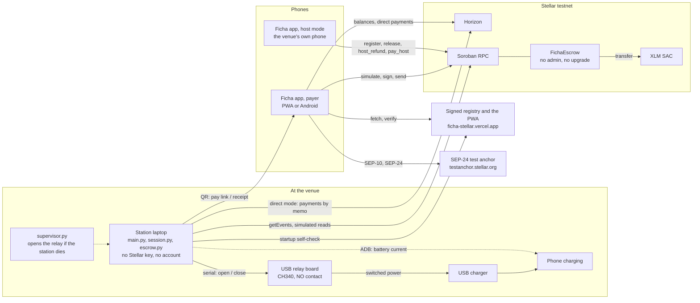
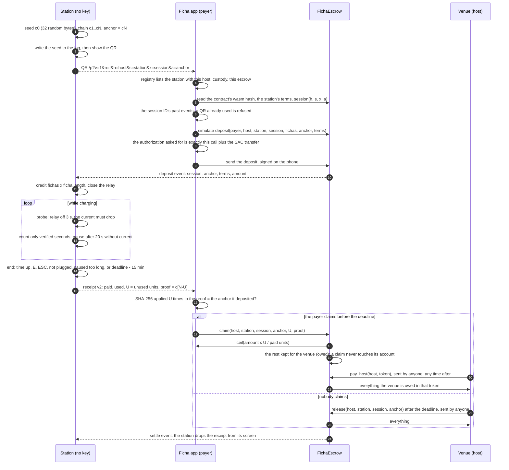
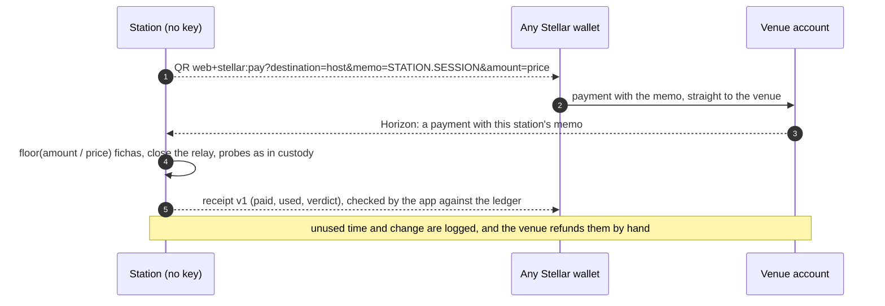
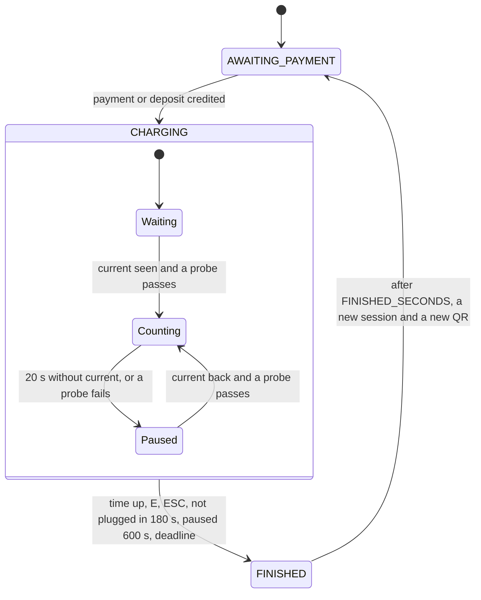

# Ficha architecture

Ficha has three moving parts that never talk to each other directly: the
**station** next to the charger, the **Ficha app** on the payer's phone, and
the **FichaEscrow** contract on Soroban. They meet on the Stellar ledger, in
a signed station registry, and in QR codes. The rules each side follows are
in [station-app-contract.md](station-app-contract.md), the binding spec; this
page is the map.

## Components



| Component | Where | Runs on | Holds | Reads / writes |
|---|---|---|---|---|
| Station | `main.py`, `session.py`, `escrow.py`, `stellar.py`, `relay.py`, `meter.py`, `qr.py`, `config.py`, `static/index.html` | a laptop next to the charger | no Stellar key and no account; the session log `sessions.jsonl`; in custody mode one random seed per session | reads Horizon (direct), the contract through Soroban RPC (custody), the registry; drives the relay and reads the meter; writes nothing to the ledger |
| Supervisor | `supervisor.py` | the same laptop | nothing | runs the station as a child process and opens the relay however the child ends |
| Relay board | LCUS V4.3, CH340, one channel | the laptop's USB | its last command | wired on the NO contact: no power unless told |
| Meter | `meter.py` | the measured phone, over ADB | nothing | the phone's battery current and voltage, once a second |
| Ficha app | `app/` (React, Vite, Capacitor) | the payer's phone, as a PWA or an Android app | the wallet's key, encrypted under the PIN, on that phone only | Horizon, Soroban RPC, the registry, the SEP-24 anchor |
| Host mode | `app/src/custody/host.ts`, `app/src/routes/host/` | the venue's own phone | the venue's key | `register`, `release`, `host_refund` and `pay_host` on the contract; reads what the contract owes the venue (`owed`), deadlines by the ledger's clock |
| FichaEscrow | `contracts/escrow/` | Soroban, testnet | deposits until they settle; venue shares until `pay_host` (every claim's, and any a venue's account could not take at release) | the token's SAC |
| Station registry | `registry/stations.json` + `.sig`, `tools/registry.py` | published with the site | which stations exist, their venue's key, terms, payment mode and contract | signed offline with the registry key; verified by stations and apps against a pinned public key |
| Ficha site | the app built by `npm run build:site`, on Vercel | | the PWA, the live registry, `assetlinks.json` for the Android App Links | static files only, no backend |

There is no Ficha server: no database, no API, no account system. The site
is static files.

## A custody session, end to end



## A direct session

Direct mode needs no contract and no Ficha app: any Stellar wallet pays the
station's SEP-7 QR. It is the default, and the only mode on the public
network.



## The station's session



The relay stays closed while waiting and paused (only a probe opens it, for
3 s), so the station can see the phone come back. The countdown stands
still in both. Details and every timing: [operators.md](operators.md),
section 6.

## The hash chain

```
c0 ──SHA-256──▶ c1 ──SHA-256──▶ c2 ── … ──▶ c[N-U] ── … ──▶ cN = anchor
secret seed                                 proof of U       public, in the
(on the station)                            unused units     pay QR and on
                                                             the contract
```

- N = most fichas × ficha length / refund unit (`YX3DGE`: 10 × 60 / 15 =
  40; `ERZGCG`: 12 × 300 / 30 = 120). The contract caps it at 256.
- The receipt reveals c[N−U]. Anyone can check it: SHA-256 applied U times
  gives the anchor. Hashing forward only proves fewer units, so nobody, the
  venue included, can turn the station's proof into a smaller refund, and
  nobody can make a bigger one without inverting SHA-256.
- The seed is c[0]. Revealing it proves N units, a full refund: that is what
  the station shows for a deposit it could not serve.
- The seed signs nothing and is no Stellar key. It can only refund that one
  session's payer, since only the payer can claim and a session settles once.

## Trust model

### Who can move money

| Who | Can | Cannot |
|---|---|---|
| The payer (a `G…` account, or a smart account `C…` with its own `__check_auth`) | deposit under the terms it read and signed; top up its own session; claim it with the station's proof until the deadline | claim more units than the proof shows; pay into a session another wallet holds; change a session's terms |
| The venue (host), with its key on its own phone | register and change its stations (a deposit signed for the old terms then fails); refund a session in full before the deadline, any part after it; receive its share (at release or host_refund at once; a claim's through `pay_host`) | claim for the payer; cut a refund before the deadline; hold a refund back or fail a claim by changing its account, before or after the payer simulates (a claim never touches it); touch another venue's stations |
| Anyone | `release` a session after its deadline (all to the venue); `pay_host` (to the venue only); read everything | anything else |
| The station | read the ledger | sign anything: it has no key and no account, and pays no fee |
| Whoever deployed the contract | nothing | there is no admin, upgrade, withdraw or constructor |
| Ficha, the operator (registry key holder, site publisher) | list, change or drop stations in the registry; publish the app | move or hold anyone's money; send a payer's deposit to a contract whose code the app does not pin |

In direct mode the payer pays the venue straight; nobody but the venue ever
holds the money, and refunds are the venue's, by hand, from the station's
log.

### What each check stops

- **A swapped QR** (someone's sticker over the station's screen): the app
  pays only stations listed in the signed registry, to the venue key listed
  there, and in custody mode only into the contract the registry names,
  whose code hash the app pins. Otherwise it refuses before signing.
- **A registry that names other code:** the app reads the named contract's
  wasm hash from the ledger and refuses any build it does not pin.
- **Terms changed between the app's check and the deposit:** the payer signs
  the terms; the contract fails the deposit (`TermsChanged`) before any
  money moves.
- **A copied QR paid with another chain:** a session is (venue, station, ID,
  anchor), so that deposit opens a session of its own, which the station
  ignores; the copier refunds itself with its own chain.
- **A venue that wants to keep a refund:** only the payer can claim; before
  the deadline the venue can only refund in full; a claim never touches the
  venue's account, so a venue that cannot receive, or that changes its
  account between the payer's simulation and the ledger to fail the claim,
  is only owed its share, and the payer is still paid. The venue collects
  what it is owed with `pay_host` (host mode's Collect button).
- **A pay page left open** while its session was paid or settled (another
  payer at the table, the E key): the app reads the session again right
  before it builds the deposit, and refuses before signing.
- **A phone whose clock is off:** the deadlines the app acts on (pay link,
  receipt, host mode) and its transactions' time bounds follow the ledger's
  close time, as the station's do.
- **A station that dies mid-session:** in custody mode the time already
  consumed is logged every 30 s; at restart the session is closed from that,
  in the payer's favour, and its receipt comes back on the screen. With a real relay, the
  supervisor opens the relay when the station process dies.
- **A registry or contract that changes under a running station** (a
  redeploy, other terms): the app pays what the newest signed registry and
  the contract say, so a custody station reads both again every minute, and
  goes out of service, its pay QR hidden, until it is restarted with the
  new values.

### The honest limits

- **A tampered station can reveal less.** The station's measurement is
  trusted, as any meter is. A station whose software the venue altered
  could reveal fewer unused units than the payer was owed. The proof stops
  everyone else, the venue included, from cutting a refund the station
  grants; it does not make the station honest. The roadmap answers this in
  two steps: the payer's app as a witness (it can see the probes' drops on
  its own battery), then a metered outlet whose attestation key signs only a
  session's split.
- **A payer who never scans the receipt gets nothing back.** The venue is
  paid in full at the deadline, as with a direct payment. The station shows
  the newest receipt that gives something back on its waiting screen until
  it is claimed or its deadline passes, taking turns with an unserved full
  refund when there is one; that copy opens from the app's Scan QR, not the
  phone's camera.
- **A copy of the exact pay link** (same ID and anchor) can be paid first.
  The real payer's deposit then fails at simulation, before signing, and the
  station serves the copier's deposit: whoever is at the station charges on
  the copier's money, or, with no phone plugged in, the session ends after
  about 4 minutes and its receipt refunds the copier. The copier pays the
  fees and gains nothing.
- **The ADB meter is a demo meter.** It needs USB debugging on the measured
  phone; the public's phones cannot be read that way.
- **Testnet only, no audit.** Custody mode is refused on the public network
  by the station, the registry tool and the app.
- **Refunds trust the asset's issuer.** An issuer can freeze a payer before
  the claim or claw back what the escrow holds, so custody takes native XLM
  only, which has no issuer.

The full list, with the rules behind each: [station-app-contract.md](station-app-contract.md),
sections 7.8 and 7.10.
