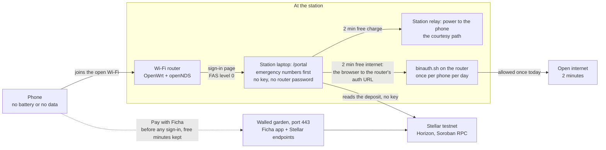

# Public safety mode: a charging point that can save a call

Ficha was made for places like cafés, shopping centres, airports and bus
stations. It now also goes where a phone can be a lifeline: places with high
rates of violence or kidnapping, remote places, and anywhere people need a
way to communicate. There, a Ficha station's own Wi-Fi gives **every phone,
once a day, 2 minutes of charging and 2 minutes of internet, free**, shows
the **local emergency numbers first**, and lets anyone **pay for more
charging with no mobile data**.

> **Ficha is not an emergency service and does not replace one.** It calls
> nobody, alerts nobody, watches nobody and does not know where anyone is. A
> station can be off, busy, out of service or without internet. In danger,
> call the emergency number directly: a voice call to it needs no internet
> and no Ficha.

| At a glance | |
|---|---|
| What a phone gets, once a day | 2 min of charging (the station's relay) and 2 min of open internet (the station's Wi-Fi router), free, no account |
| Paying | always reachable on the station's Wi-Fi, before any sign-in, without spending the free minutes |
| Emergency numbers | first on the Wi-Fi's sign-in page and on the station screen: 112 in Portugal (the whole EU); 190, 192 and 193 in Brazil |
| Privacy | a phone is a salted hash of its Wi-Fi MAC address; the salt changes and is deleted every day; no MAC, IP or name is kept |
| Money | none moves for a free minute: it is a courtesy, like the operator's free courtesy minute |
| Keys | the station still holds no Stellar key, and no router password either |
| Default | off (`WIFI_PORTAL=off`): a station without these settings behaves exactly as before |
| Status | the station side is built and tested; the router side (OpenWrt and openNDS) is tested in WSL on a fake router, and has not run on the real router yet |

The station's side in detail: [free-minutes.md](free-minutes.md). The
router's: [openwrt/README.md](../openwrt/README.md). The settings:
[operators.md, section 3](operators.md#free-emergency-minutes).

## Why

A phone is how most people call for help, tell someone where they are, find
their way home, or pay. When its battery dies, or it has no data plan or no
roaming, a person can be cut off at the worst moment:

- someone arriving at a bus station at night with a dead phone, who cannot
  call home or a ride;
- a traveller off a plane with no roaming data, who cannot reach anyone or
  pay for anything;
- a person in a neighbourhood with high rates of violence or kidnapping, who
  needs to tell someone where they are, now;
- someone in a remote place where the station's Wi-Fi is the only internet
  around.

### Paying with no mobile data

The paid flow needs the phone to reach the Ficha app and the Stellar
network. Without mobile data it cannot, unless the station's Wi-Fi lets it.
On a station's Wi-Fi the Ficha app and the Stellar endpoints it uses are open
before any sign-in (the router's *walled garden*), so anyone can pay for more
charging without spending the free minutes. A payment made during a free
charge turns it into the paid session, exactly as during the operator's
courtesy minute: the relay stays closed, and then, as for any paid session,
a 3-second probe checks that the phone charges from this station. Paying buys
charging time: past the walled garden, the internet stays the free 2
minutes.

### The human side

A dead phone is rarely just a dead phone. It is a parent waiting for a
message that does not come, a ride that cannot be called, a person who
cannot say "I'm OK" or "come and get me", or who has to ask a stranger for
help. Two minutes are not much, but they are often enough to switch a phone
back on, make one call, send one message or share a location. In the
author's words, there is a heart here that translates real emotions. The
free minutes are that part of Ficha: no account, no payment, no question
asked, once a day for every phone.

What two minutes give, as an estimate, not a measurement: a phone that
charges at 1 to 3 A, as phones on USB chargers commonly do, takes in about
30 to 100 mAh in two minutes. That is a few percent of a typical battery at
most, under half a watt-hour, a fraction of a cent of electricity. It varies
from phone to phone and charger to charger.

## How it works

A visit, step by step:

1. **The phone joins the station's Wi-Fi.** Its name is on the station
   screen, next to a QR that joins it; at the event it is an open network,
   with no password.
2. **The router sends it to the station's page.** The router runs OpenWrt
   with openNDS, a captive portal, which sends every new phone to the
   station's own page, `/portal`; phones open it by themselves in their
   sign-in window. The page is English or Portuguese (the phone's language),
   made for a small screen, with no script and nothing from another host, so
   it needs nothing from the internet.
3. **On the page, in this order:** the emergency numbers as large one-tap
   call buttons; **2 min free charge** and **2 min free internet**, with what
   this phone has left today; **Pay with Ficha**, the pay link of the
   session on the station screen ("Add time to the session now charging"
   while one runs); a short safety and privacy note.
4. **Free charge.** The station closes its own relay for 2 minutes, the
   path of the operator's courtesy minute, on the session already on screen,
   so its pay QR stays valid. The screen reads "free charge" and counts
   down; the phone's page counts down too.
5. **Free internet.** The station writes down the grant and sends the
   phone's browser to the router's sign-in address. The router's own script
   (`binauth.sh`) checks this phone's quota for the day and opens the
   internet for 2 minutes; then the sign-in page is back.
6. **Pay with Ficha.** The app opens (best in the phone's browser: a sign-in
   window has its own storage, without the wallet); it reaches the Ficha
   site and Stellar through the walled garden; the station sees the deposit
   on the ledger, with no key, and the paid session goes on.



Who decides what:

| | decided by | how |
|---|---|---|
| The free charge, once per phone per day | the station | its relay, for `FREE_CHARGE_SECONDS`; the day's ledger in `freeminutes.py` |
| The free internet, once per phone per day | the router | openNDS and `binauth.sh`, per MAC address, per local day; the station only writes the grant down and redirects |
| Payments | the walled garden | the Ficha site and the Stellar endpoints the app uses, open on port 443 before any sign-in |
| The paid session | the station and the ledger, as always | prepaid, money only to the venue or back to the payer, paid time counted only while charging is verified |

The station holds **no key and no password**: no Stellar key, no router
password, and no shared key with the router (openNDS's "FAS level 0", the
way it hands a phone to the station's page, needs none). Its only random
values are the custody sessions' seeds, which sign nothing, and the day's
salt, which protects privacy and is deleted every day.

**Without a router**, `WIFI_PORTAL=simulate` shows the same page on the
station's own computer: the free charge closes the relay as usual, and the
free internet is written down as "Internet granted (simulated)", with
nothing given. The page and the station screen say SIMULATED. The demo
`.env` examples run this way.

**Without internet** (the router's uplink down), payments and the free
internet cannot work. The page itself needs nothing from the internet and
the free charge needs only the station and its relay; whether openNDS still
sends phones to the page with its uplink down is to be checked on the real
router.

## Privacy by design

A phone is recognised by its Wi-Fi MAC address, because that is what the
router and the station can see without asking anything of the person. The
address is never stored:

| Where | What is kept | For how long |
|---|---|---|
| The station | per phone: `HMAC-SHA256(salt of the day, MAC)`, its first 16 hex digits, and what it used; the salt, 32 random bytes made for the day | that day only: at local midnight the salt and the day's file are deleted (a running station checks every minute; one that was off deletes them when it starts) |
| The station's log (`sessions.jsonl`) | one line per grant: `{"kind": "free_grant", "device": "<id of the day>", "what": "charge" or "internet", "seconds": 120, "at": ...}` | as long as the log; the id cannot be linked to another day's, nor traced back to a MAC once its salt is gone |
| The router | per phone: `sha256(salt \| MAC)` and the seconds given; a 256-bit salt of the day | that day only, in memory (`/tmp`): the whole day's folder goes when the date changes |
| The router's log | `free_grant what=internet id=<16 hex> seconds=120` | the router's log, in memory |
| Nowhere | the MAC address, the IP address, a name, a phone number, an account | |

The station reads a phone's MAC address from its own neighbour (ARP) table,
for the one request that asks, and keeps it in memory for that request only.

**Why the allowance starts over at midnight, not after a rolling 24 hours:**
a rolling window would have to recognise a phone across two daily salts,
which is exactly the linking the daily salt exists to prevent.

What privacy cannot cover here, plainly:

- While the day lasts, whoever can read the station's disk, or the router's
  memory, could test candidate MAC addresses against that day's salt (there
  are few enough to try them all). That is why the salt lives no longer than
  its day.
- The router necessarily holds MAC addresses in memory while it serves a
  phone (its address tables, its DHCP leases, openNDS's client list), as any
  Wi-Fi router does. openNDS logs them from debug level 1 on; Ficha's setup
  sets level 0 (and openNDS 11's own BinAuth log, in `/tmp/ndslog`, is on
  regardless: [openwrt/README.md](../openwrt/README.md#how-binauthsh-holds-the-2-minutes)).
- The phone's page says it in one line: "Your phone is recognised only by a
  code that changes every day. Ficha keeps no name, no phone number, no IP
  and no MAC address." That line is not a full privacy notice
  ([Legal, to verify](#legal-to-verify)).

## Abuse limits

What stops one person from taking what is meant for everyone:

- **Once per phone per day**, for the charge and for the internet, each kept
  apart: the station's ledger for the charge, the router's script for the
  internet's sign-in.
- **A free charge never interrupts a paid one.** It is refused during a paid
  session, the operator's courtesy minute or another free charge, while a
  finished session's screen (with its receipt) is up, and with the relay not
  answering. One at a time. It neither waits for nor starts the operator's
  courtesy cooldown.
- **A payment is never lost to a free charge.** The free charge runs on the
  session on screen, so a payment made to its QR is credited and carries on.
- **Only a phone on the station's Wi-Fi.** With the router, a request must
  come through the router's sign-in, and the phone and the station's own
  address must be on the router's network; otherwise the page says so and
  nothing is used. A request from another address than the one the router
  saw, or with no entry in the station's neighbour table, is refused too.
- **The station's own controls stay with the operator.** With the page on,
  the station screen, its keys (ESC, C, E) and its debug page answer only to
  the station's own computer; a phone that opens the station's address gets
  the page.
- **Forms only from the page itself**, small ones, each answered with a
  redirect, so a reload never asks twice; and the station sends a browser
  only to a router's sign-in address on a private network, so it can never
  be used as an open redirect.
- **The router fails closed.** Anything unexpected (an unreadable count, a
  broken salt, a malformed address, a bad setting) refuses the free internet;
  payments still work.
- **The station refuses to start** a setup that cannot work: free minutes
  without the page, the page without emergency numbers, the router mode on a
  loopback address or without the Wi-Fi's name, fake payments reachable from
  the network, a malformed number, seconds out of range.

## Honest limits

- **The 2 minutes of internet are a courtesy, not a hard limit.** The walled
  garden opens, for every phone and before any sign-in, the network addresses
  behind the Ficha site and the Stellar endpoints. Those addresses belong to
  hosting providers that serve many other sites from them, so a determined
  user can reach other sites through them (a web proxy hosted with the same
  provider is free internet for as long as one likes) and can tunnel through
  the router's DNS. The cost of that gap is someone's free internet, never
  money. A hard limit would need the app and every Stellar endpoint it uses
  on addresses of their own, or behind a proxy on the station's network
  ([openwrt/README.md](../openwrt/README.md#the-2-minutes-are-a-courtesy-not-a-hard-limit)).
- **MAC randomisation.** Recent phones use a private Wi-Fi address per
  network, and some change it over time or on request. A phone that changes
  its address counts as a new phone. The free minutes are a courtesy worth
  two minutes of power or internet; the paid flow does not depend on them.
- **Restarts.** The router keeps its day in memory: a reboot, or its clock
  jumping to another date, starts the day over. The station keeps its day on
  disk, so a restart never gives a charge twice.
- **The free charge powers whatever is plugged in**, like the courtesy
  minute: it is for the person standing at the station.
- **The sign-in window is not the phone's browser.** It has its own storage,
  so a wallet made in the browser is not there; the page says to open the
  pay link in the browser or the Ficha app.
- **Private DNS in strict mode** (a DNS server set by name on the phone)
  cannot resolve the walled garden before sign-in; the phones' usual
  automatic setting works.
- **The station must be on the router's network only.** If its computer is
  also on another network marked private, someone there could write that
  network's gateway into the page's address by hand
  ([openwrt/README.md](../openwrt/README.md#4-the-station-on-its-fixed-address-3-min)).
- **Not yet on a real router.** `binauth.sh` and `setup.sh` are tested in
  WSL with busybox, on a fake router; openNDS itself has not run them yet.

## Who can fund the free minutes

Today nobody pays for a free minute and no money moves: the venue gives the
electricity (an estimate above: a fraction of a cent per free charge) and
the internet uplink. Who could pay for them, in each place:

| Who | Why | Where |
|---|---|---|
| The venue | a service to its public that brings people to a station where paid minutes are one scan away | bus and train stations, airports, shopping centres |
| A city or a transport authority | public-safety spending on something people can use at once | transit hubs, squares, night-life streets, areas with high rates of violence or kidnapping |
| An NGO | a lifeline where there is no other | remote places, shelters, places hit by a disaster |
| A sponsor | its name next to a useful public service | any of the above |

**On the roadmap: sponsored fichas on the ledger.** A sponsor would deposit
fichas for a station, and each free charge would draw one: the venue is paid
for its electricity, and the sponsor sees on the ledger exactly how many free
minutes it paid for. Not built. The escrow has no sponsor deposit today, and
the product rules would still hold: prepaid, money only to the venue or back
to the sponsor who paid it, the operator never holds it, the station holds no
key, and no device id ever goes on the ledger.

## Emergency numbers

The station's operator sets them in `.env`, as `label number` pairs
separated by `;`, up to 6:

| Where | Number | `EMERGENCY_NUMBERS` |
|---|---|---|
| Portugal (and every EU country) | 112, the European emergency number | `'Emergency 112'` |
| Brazil | 190 Polícia Militar (police), 192 SAMU (ambulance), 193 Corpo de Bombeiros (fire) | `'Polícia 190; SAMU 192; Bombeiros 193'` |

They are shown first on the Wi-Fi's page, as large one-tap call buttons, and
in a band on the station screen. The page's safety note starts with the first
of them: "In danger? Call 112 first: it is free, even without internet." Calls
to these numbers are free of charge, and a voice call needs no internet, but
it needs a phone with some battery and mobile coverage: that is what the
free charge is for. Check the numbers with the local authorities before a
station goes live; an operator may list a local helpline too.

**Again: Ficha does not replace emergency services.** The station shows the
numbers and can keep a phone alive for two minutes. It does not call, alert,
track or locate anyone, and nothing in it is monitored. It can be out of
service when needed most.

## Legal, to verify

Nothing here is legal advice, and Ficha claims no compliance with any of
these rules. They are the questions a lawyer in each country must answer
before a public station runs this mode.

**Brazil**

- **Marco Civil da Internet** (Law 12.965/2014) and its regulation
  (Decree 8.771/2016), on connection providers. As we read it, the duty to
  keep connection records for one year falls on the autonomous system's
  administrator (art. 13), and a connection provider, paid or free, must not
  keep records of access to applications (art. 14). To verify: whether a
  venue or a station operator that offers free Wi-Fi is a connection
  provider with any duty to keep connection records, who would keep them (the
  venue's internet provider, the router), and how that fits a design that
  keeps no IP and no MAC address.
- **Anatel's rules for offering Wi-Fi to the public.** Whether a free,
  time-limited Wi-Fi at a station is a telecommunications service that needs
  an authorisation or a registration (Anatel's rules exempt some small
  providers), and the router's certification by Anatel for use in Brazil.
- **LGPD** (Law 13.709/2018): whether a MAC address and its daily hash are
  personal data here, who the controller is (the venue, the operator), the
  legal basis, and the notice owed to the person.

**Portugal and the EU**

- **GDPR** (Regulation (EU) 2016/679). A MAC address is an online identifier
  that can be personal data (recital 30), and a salted hash of it is
  pseudonymised data, still personal data while the salt exists (recital
  26). Deleting the salt every day aims at data minimisation and storage
  limitation (art. 5(1)(c) and (e)). To verify: the controller, the legal
  basis (art. 6) for reading the address to share a daily allowance fairly,
  the information owed to the person (art. 13; the page's one line is not
  enough), whether a day's ids become anonymous once its salt is deleted,
  and the router's own logs.
- **ePrivacy** (Directive 2002/58/EC; in Portugal, Law 41/2004): whether
  reading a phone's MAC address from the station's own neighbour table, not
  from the phone, falls under its rules on terminal equipment.
- **Portugal's Electronic Communications Law** (Law 16/2022), supervised by
  ANACOM: whether free public Wi-Fi at a station is a publicly available
  electronic communications service, and what that asks of the venue.

**Everywhere**: how the emergency numbers and the safety note are worded (no
promise of help that the station cannot give), and who answers for a station
that is out of service when someone needs it.

## Try it

On any computer, simulated (no router, no relay board, fake payments): set
up the station as in the README's [Run it locally](../README.md#run-it-locally),
with `.env.example` copied to `.env`. It already has `WIFI_PORTAL=simulate`,
120 + 120 seconds and `EMERGENCY_NUMBERS='Emergency 112'`.

```bash
python main.py
# station screen: http://127.0.0.1:8000   the Wi-Fi's page: http://127.0.0.1:8000/portal
```

On the page, tap **2 min free charge**:
the screen reads "free charge" and counts 2:00 down. Pay with
`curl -X POST localhost:8000/debug/pay -H "content-type: application/json" -d "{\"amount\": \"2\"}"`
and the free charge becomes the paid session. **2 min free internet**
says "Internet granted (simulated)". `?lang=pt` shows the page in Portuguese,
and `?clientmac=02:11:22:33:44:55` plays another phone (a test address, taken
from the station's own computer only).

With the router: [openwrt/README.md](../openwrt/README.md) (about 20 minutes
at the event) and [operators.md, section 3](operators.md#free-emergency-minutes).

Tests, as they printed on 23 October 2026: `python smoke_test.py`, 574
station checks, the free minutes among them (off by default, the refusals,
the salt's rotation, no MAC on disk, once per phone per day, the paid session
first, the carry-over, the router's redirect, the page with no network); in
WSL or Linux with busybox, `sh openwrt/test-binauth.sh` (61 checks) and
`sh openwrt/test-setup.sh` (83 checks).

## Next, for this mode

Not built; in order:

1. **The real router**: `openwrt/setup.sh` on the travel
   router, a phone through the whole visit above.
2. **Sponsored fichas on the ledger** ([above](#who-can-fund-the-free-minutes)).
3. **A hard limit on the free internet**: the app and the Stellar endpoints
   on addresses of their own, or a proxy on the station's network.
4. **A pilot** with a venue, a city or an NGO, in Portugal or in Brazil, once
   the legal questions above have answers.
